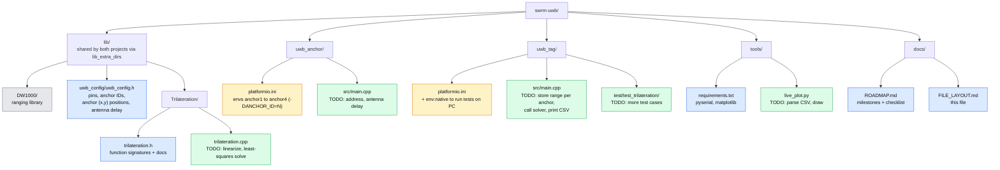
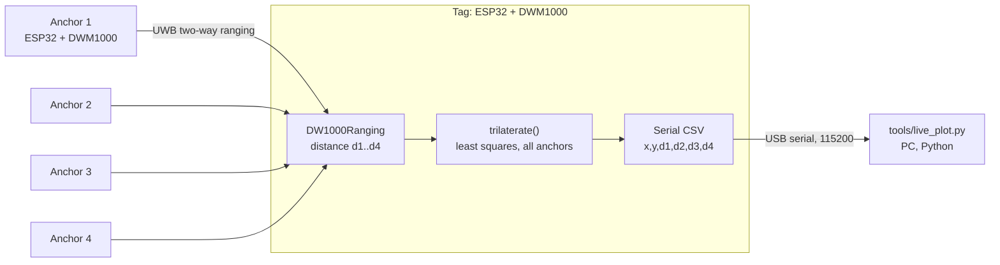

# File Layout

Planned structure for the SWRM UWB positioning system: ESP32 + DWM1000 (DW1000 chip), 4 anchors, 1 tag, PlatformIO.

- **C++ (ESP32, PlatformIO):** ranging firmware and trilateration. The tag solves its own position.
- **Python (PC):** reads the tag's serial output for live plotting and accuracy logging.

## Repo layout

| Color | Meaning |
|---|---|
| Gray | Already in the repo |
| Blue | New, written as starter code |
| Yellow | Existing file, edited |
| Green | Starter code with **TODO blanks to fill in** |

## How data flows

The DWM1000 talks to the ESP32 over SPI. On the Makerfabs ESP32 UWB board these are the pins: SCK 18, MISO 19, MOSI 23, CS 4, RST 27, IRQ 34. They live in `uwb_config.h`, so a custom PCB can reuse them.

## Milestones

1. **Smoke test:** read the DW1000 device ID (`DECA0130`) over SPI.
2. **Two-board ranging:** check against a tape measure at 1, 2 and 5 m.
3. **Antenna delay calibration:** error of about 10 cm or less at a known distance.
4. **4 anchors:** tag collects a distance from each.
5. **Trilateration:** unit tests pass on PC, then the solver runs on the tag.
6. **Live plot + accuracy test:** marked spots, with and without blocking.
7. **Later:** Kalman smoothing, then the custom PCB on the same pins.
